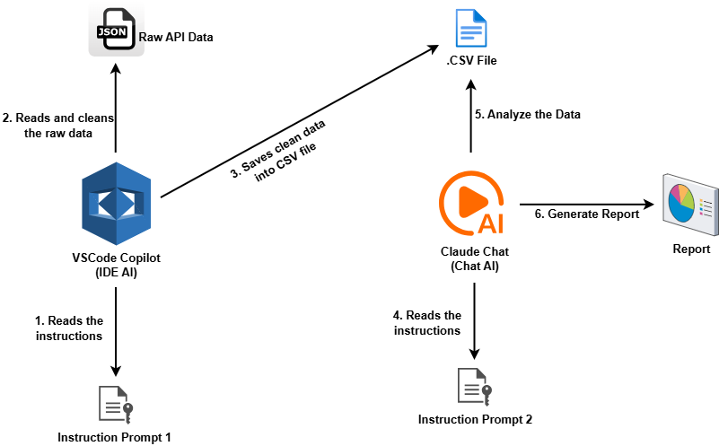
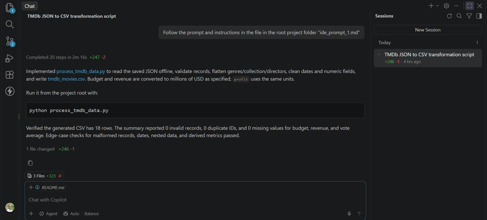
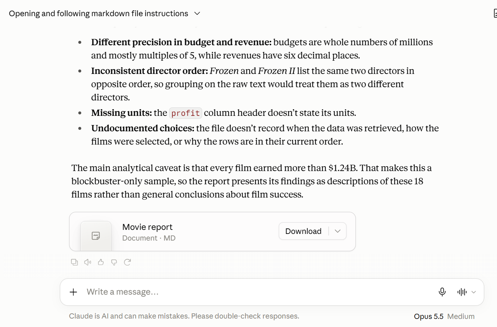

# Multi-Stage AI Workflow Across UX Types

## Project: TMDb Movie Data Analysis and Reporting Workflow

This project demonstrates a multi-stage AI workflow using two different AI user experiences to transform raw movie data into an analytical report. GitHub Copilot in VS Code processes saved TMDb API responses into a structured CSV file, while Claude AI analyzes the cleaned data and generates a Markdown report.

---

## Workflow Diagram



## Step 1: Implemented IDE AI: 

The IDE AI tool used was **GitHub Copilot in VS Code.**

Copilot helped create `process_tmdb_data.py`, which reads the saved API responses, cleans and transforms the data, and exports the results to `tmdb_movies.csv`. 

The processing instructions were stored in `ide_prompt_1.md`.



## Step 2: Implemented Chat AI:

The chat AI tool used was **Claude AI**.

Claude analyzed the generated `tmdb_movies.csv` file and produced `movie_report.md`, summarizing the dataset's financial performance, ratings, popularity, key findings, and limitations. 

The analysis instructions were stored in `chat_ai_prompt_2.md`.



## How to Run the Project

### Prerequisites

- Python installed on your computer.
- A TMDb API access token (You can register on the website to get it).
- The required Python packages installed.

### Execution

1. **Fetch the data:** Configure your TMDb credentials in `.env` and run `api_call.py` to retrieve movie data and save it to `tmdb_movies_raw.json`.

   ```bash
   python api_call.py
   ```

2. **Process the data:** Ask GitHub Copilot in VS Code to read the instructions in `ide_prompt_1.md` to create or run `process_tmdb_data.py`.

   ```bash
   python process_tmdb_data.py
   ```

   This generates `tmdb_movies.csv`.

3. **Generate the report:** Upload `tmdb_movies.csv` and `chat_ai_prompt_2` to Claude AI and ask the it to read the instructions provided in the prompt. Save the resulting report as `movie_report.md`.

## Project Outputs

- `tmdb_movies_raw.json`: Raw movie data retrieved from the TMDb API.
- `process_tmdb_data.py`: Script for cleaning and transforming the data.
- `tmdb_movies.csv`: Structured dataset ready for analysis.
- `movie_report.md`: Final analytical report generated by Claude AI.
- `ide_prompt_1.md` and `chat_ai_prompt_2`: Prompts used at each AI stage.

This project demonstrates how different AI user experiences can be connected into a practical workflow, with each stage producing an output used by the next.